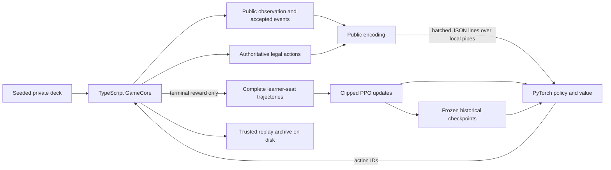

# AI-7: terminal-only Banqi self-play

Branch B is maintained on the existing `experiment/selfplay-zero` branch and
worktree, based on `c377a68`. GameCore
and `docs/game-rules.md` must exactly match
`973bafe42f66e3414878afb3284e1f54216cbe4d`. Startup checks tracked differences and
uncommitted/untracked Core files. Existing heuristic agents and the browser default
are unchanged. The original runs used uncommitted source snapshots. The implementation and
small result reports were subsequently committed at the owner's request; the
training commands do not push, merge, or deploy changes.

The [overnight campaign guide](ai7-overnight.md) describes the subsequent controlled
three-architecture experiment, exact resume support, and persistent local runner.
The first-pilot protocol below remains documented separately for reproducibility.

## Architecture



One persistent Node child holds a batch of independent games. Python owns one
shared policy/value MLP, optimization, opponent sampling, and explicit action RNGs.
No game rules are implemented in Python. `applyAction`, `getLegalActions`,
`getObservation`, existing seeded deck generation, Core baseline checking, agent
adapters, and `reconstructGame` are reused. Archived transcripts use the existing
`initialDeck`/accepted `actions`/`publicHistory`/`finalState` representation, with
every stored transcript independently replayed before writing.

The existing tournament runner creates deep snapshots and decision-protocol
envelopes each ply. The training adapter avoids that bookkeeping while retaining
the identical Core transition path. EV and AI-6A adapters exist only on the
evaluation path. The training collector rejects heuristic opponent identifiers.

## Public observation and actions: `public-v1`

Core indexing is eight rows of four columns, row-major. This is the same 32-square
board sometimes described as 4×8; there is no transposition.

| Transport field          | Definition                                                                                                                                                      |
| ------------------------ | --------------------------------------------------------------------------------------------------------------------------------------------------------------- |
| `board[32]`              | 0 empty, 1 hidden, 2–15 revealed color/rank categories                                                                                                          |
| `references[32]`         | 0 absent, otherwise the piece's original reveal-square index + 1; follows that physical piece after movement                                                    |
| `hiddenInventory[14]`    | Initial rule inventory minus public FLIP events, RED ranks then BLACK ranks                                                                                     |
| `remainingInventory[14]` | Initial rule inventory minus publicly observed captures, including unrevealed stock                                                                             |
| `player`                 | Acting seat: P1=0, P2=1                                                                                                                                         |
| `color`                  | Acting player's assignment: unassigned=0, RED=1, BLACK=2                                                                                                        |
| `quiet`                  | Quiet counter reconstructed from accepted public events                                                                                                         |
| `ply`                    | Accepted public-prefix length                                                                                                                                   |
| `history[≤20][10]`       | Oldest to newest accepted events: type, actor, from+1, destination+1, mover reference, target reference, mover rank, mover color, captured rank, captured color |
| `legal[]`                | Legal action IDs from Core; this sparse list becomes the 1,056-entry Boolean mask                                                                               |

Rank categories follow the rule distribution's declaration order: GENERAL,
ADVISOR, ELEPHANT, CHARIOT, HORSE, CANNON, SOLDIER. They have no assigned strategic
values. A FLIP's from field and absent captured fields are zero. A FLIP's new
reference is its public reveal square, independent of private piece IDs. References
are never reused: each initial square can be flipped only once. Capturing removes
the target reference. The latest 20 accepted events match the Chase v4 window;
stable references retain physical continuity from earlier reveals. This is a
bounded feedforward history representation, not full public-history sequence
modeling. Core retains the complete authoritative history-dependent rule state,
and its legal mask remains authoritative.

The 2,163-float network input concatenates board one-hot categories (512), board
reference one-hot categories including absence (1,056), inventory counts / 5 (28),
seat/color one-hot plus quiet/60 and ply/4096 (7), and 20 padded event encodings
(560). Event type, actor, mover/captured rank and color are categorical; event
coordinates and public references are /32. Padding is all zero. Counters are
scaled, not clipped. No material totals, mobility, threats, tactical scores, seed,
deck, private chase ledger, or engine piece IDs enter the network. Public raw piece
counts are game facts, not hand-designed values.

Action IDs are `FLIP(position) = position` and
`MOVE(from,to) = 32 + from*32 + to`, including the always-illegal diagonal IDs.
Illegal logits are negative infinity. Empty masks cannot issue policy decisions.
Core independently validates every submitted action, including cannon screens and
Chase v4. Invalid submissions throw without changing the game.

## PPO and outcome ownership

The network has two 128-unit Tanh hidden layers, a 1,056-logit policy head, and one
scalar value head: 429,857 parameters. All parameters start randomly. There is no
pretraining, search, recurrent layer, transformer, or handcrafted evaluator.

Each game randomly chooses the learner's seat. Its opponent is fixed throughout
that game. All learner decisions in a trajectory therefore share one player's
perspective; opponent actions are discarded from PPO samples. Rewards are zero
until Core terminates. The final learner decision receives that learner's +1/0/−1
outcome, including games ended by an opponent action. P1 and P2 rewards sum to zero.
The next `currentPlayer` after termination is never used to infer the winner.

Complete games avoid truncation/bootstrap ambiguities. GAE uses gamma=1 and
lambda=1 in V1, so each value target is the actual terminal learner outcome and
each advantage is outcome minus the old value. No discount introduces a hidden
preference for quicker wins. Interrupted games are reported as incomplete, omitted
from updates, and never converted into draws. A 4,096-ply safety bound raises an
error instead of inventing a result.

Defaults: Adam 3e-4 with epsilon 1e-5; 4 PPO epochs; minibatches of 256; clipping
0.2; value coefficient 0.5; entropy coefficient 0.01; gradient norm cap 0.5; stop
the current optimization pass if approximate KL exceeds 0.03. Both raw entropy
and entropy/log(legal count) are logged. A single legal action has normalized
entropy zero. Explained variance describes rollout-time value predictions.

Updates 1–4 sample current-policy opponents with probability .8 and uniform legal
Random with .2. Later sampling is current .5, Random .1, uniform recent checkpoints
.25, and uniform older checkpoints .15. Until more checkpoints exist, the initial
randomly initialized network fills historical slots. The in-memory pool retains
initial/early snapshots, the latest three, and one middle snapshot. No complex
league or opponent strength labels are used. Models stay fixed during collection.

## Running

Use a real local `node_modules` directory: pnpm's task-state handling rejects a
symlink replacing that directory. Dependencies remain excluded from experiment size.

```sh
pnpm install --frozen-lockfile
python3 -m venv .venv
.venv/bin/python -m pip install -r scripts/ai7/requirements.txt

pnpm exec vitest run scripts/ai7/tests packages/game-core/tests
.venv/bin/python -m unittest scripts.ai7.tests.test_learning -v
.venv/bin/python -m scripts.ai7.benchmark

.venv/bin/python -m scripts.ai7.train \
  --output benchmark-results/ai7-selfplay/pilot-seed7-20261114 \
  --seed 7 --training-seconds 7200 --max-env-steps 262144 \
  --max-updates 64 --batch-games 16 --threads 2 --device cpu

.venv/bin/python -m scripts.ai7.evaluate \
  --checkpoints benchmark-results/ai7-selfplay/pilot-seed7-20261114/initial.pt \
                benchmark-results/ai7-selfplay/pilot-seed7-20261114/final.pt \
  --output benchmark-results/ai7-selfplay/pilot-eval-random \
  --pairs 128 --seed-start 2000000 --opponents random
```

On machines setting an unwritable `PYTHONPYCACHEPREFIX`, set it to a writable
temporary directory before invoking Python. Training/evaluation output directories
must be new, under `benchmark-results/ai7-selfplay/`. Reusing a run name fails
rather than overwriting results. Existing historical benchmarks are untouched.

Evaluation also accepts `--opponents ev ai6a` and
`--historical path/to/frozen.pt`. Opponent models are loaded once and remain frozen.
Use checkpoint paths with distinct stems when comparing multiple checkpoints.

Generate standalone learning curves after evaluation:

```sh
.venv/bin/python -m scripts.ai7.report \
  --run benchmark-results/ai7-selfplay/pilot-seed7-20261114 \
  --evaluation benchmark-results/ai7-selfplay/pilot-eval-random-complete
```

The completed pilot and its limitations are reported in
[the pilot report](ai7-pilot-report.md).

## Budget and evaluation protocol

The declared pilot stops at the first of 262,144 environment steps, 64 updates, or
7,200 seconds of training-window wall time. The step target is checked between
complete game batches, so the last batch can exceed it. The time cap is checked
every collection tick and optimization minibatch; an in-flight operation can finish
just after the deadline. Periodic validation consumes the same wall-time window,
making the training allowance conservative. No automatic extension is implemented.
CPU training is capped at two Torch threads and one interop thread; Node has one
game-simulation process. Batch size is capped at 32 games. Checkpoint output is
bounded by a maximum 128 updates and a configurable save interval; no files need
to be deleted to respect retention bounds.

The entire AI-7 experiment tree is capped at 5,000,000,000 bytes, excluding `.venv`
and Node dependencies outside that tree. Python checks space before each rollout
with headroom for checkpoints; Node checks exact archive bytes before writing.
Only one training replay per update and a configurable small evaluation sample
are retained. Raw compact results are retained for every completed game.

Training deck seeds are sampled below 900,000. Validation uses 1,000,000–1,000,007.
Final held-out evaluation uses 2,000,000–2,000,127, both seats on each same deck.
The final checkpoint is selected by its predetermined training endpoint, not by
examining final-test results. Validation games never enter optimization. Evaluation
resets independent stochastic action streams per focal/opponent role and deck seed
for every checkpoint. Frozen policies do not learn during evaluation.

Scores are win=1, draw=.5, loss=0, averaged over the two seat-swapped games per seed.
95% Hoeffding confidence intervals use independent seed pairs, matching the existing
tournament's statistical unit. Trained-minus-initial differences additionally use
a paired-deck bootstrap (10,000 resamples, fixed seed), with a conservative bounded
pair-difference interval alongside it. Bootstrap intervals are approximate. Report
completed/attempted games and inspect draws separately from score. One training
seed cannot establish robustness across independent learning runs.

Behavior logs include both draw reasons, plies, captures, FLIPs, hidden pieces at
termination, immediate reversals of the previous own move, and returns to the same
public board/seat/assignment. The latter deliberately omits history/counters and is
a behavioral repetition metric, not a Core repetition rule. Public-count-lead
conversion uses **unweighted revealed piece count**, records whether the learner
ever led, and reports its eventual W/D/L. It is an explicitly limited offline
diagnostic; it does not establish valuable-material advantage or endgame skill.

Each checkpoint includes weights, optimizer state, config, step count, architecture
and observation versions, Core revision, Torch/NumPy/Python RNG states, opponent
sampling RNG state, and historical-pool identifiers. The run manifest records Git
revision/status, exact source hashes, runtime/dependency versions, and hardware.
Checkpoint reload and exact subsequent Adam updates are tested. The V1 training CLI
started new experiments; the subsequent overnight infrastructure now adds exact
`--resume` support, including optimizer, RNG, historical opponents, and counters.

## Correctness and interpretation

Required gates cover action encoding, masking, hidden-layout/private-ID invariance,
single-square reveals, public identity continuity, both reward owners, complete
deterministic games and replay, Core legal/terminal parity, NO_PROGRESS, Chase v4
rejections and chase-only stalemate, finite PPO updates, exact optimizer reload,
repeatable evaluation, and exclusion of incomplete trajectories. Existing Core
tests also cover capture geometry and cannon screens. Substantive training starts
only after these gates pass.

Policy parameter changes establish learning machinery, not useful Banqi strategy.
Loss reductions do not establish strength. More draws can reduce losses without
better winning conversion. Captures/FLIPs also occur under Random and legal masks,
so their mere presence is not evidence of emergent tactics. Tactical/defensive/FLIP
and coordination claims need independent behavioral probes or reviewed games and
repeatable strength results. An inconclusive pilot remains inconclusive.

The implementation follows the clipped objective in the
[PPO paper](https://arxiv.org/abs/1707.06347) and PyTorch's
[categorical distribution interface](https://docs.pytorch.org/docs/stable/distributions.html).
Device detection uses the documented
[MPS backend](https://docs.pytorch.org/docs/main/notes/mps.html).
